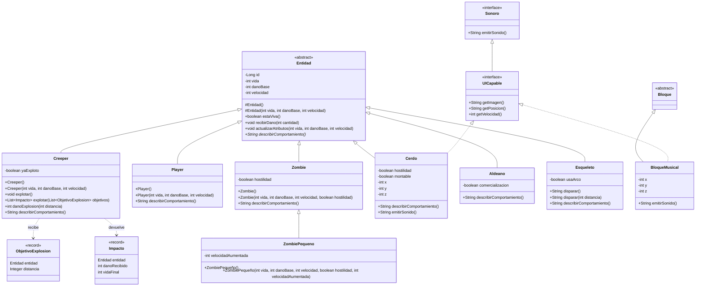
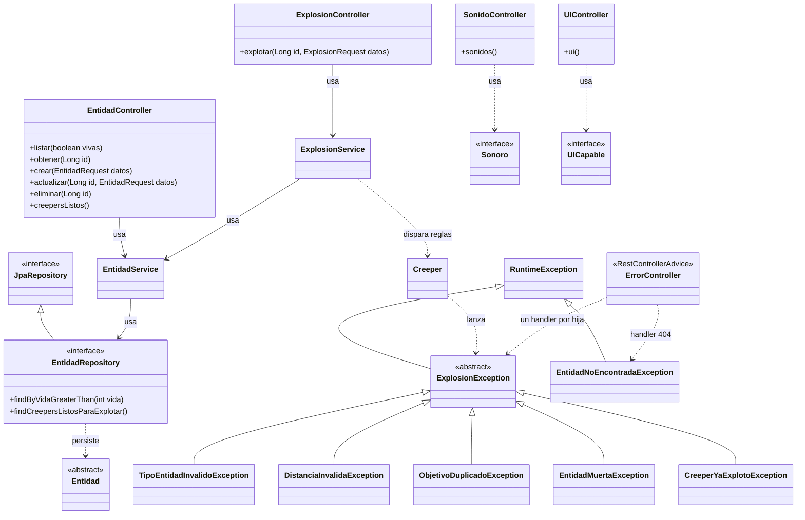

# mr-taller-git-2026

API REST de entidades de Minecraft desarrollada para Lenguaje de Programacion 3.
Guarda las entidades en H2, expone un CRUD y simula explosiones de creepers sobre
jugadores y zombies (ejercicio POO-08).

## Como ejecutar

```bash
./mvnw spring-boot:run
```

La aplicacion queda disponible en `http://localhost:8080`. `GET /` responde
`API de Minecraft de Mateo. Servicio funcionando.`

## Configuracion de H2

`src/main/resources/application.properties`:

| Propiedad | Valor | Para que sirve |
| --- | --- | --- |
| `spring.datasource.url` | `jdbc:h2:file:./data/entidades` | Guarda la base en el archivo `./data/entidades.mv.db`, asi los datos sobreviven a un reinicio. |
| `spring.datasource.username` | `sa` | Usuario con el que la aplicacion (y la consola) se conectan a H2. |
| `spring.datasource.password` | vacio | La base local de desarrollo no tiene clave. |
| `spring.jpa.hibernate.ddl-auto` | `update` | Hibernate crea la tabla si no existe y agrega columnas nuevas sin borrar los datos. |
| `spring.jpa.open-in-view` | `false` | La sesion de JPA se cierra al terminar el servicio; el controller no dispara consultas al serializar. |
| `spring.h2.console.enabled` | `true` | Habilita la consola web de H2 en `/h2-console` (solo para desarrollo). |

La carpeta `data/` esta en `.gitignore`. Las pruebas usan otra base, en memoria
(`src/test/resources/application.properties`, `jdbc:h2:mem:` con `create-drop`).

Consola: abrir `http://localhost:8080/h2-console`, JDBC URL `jdbc:h2:file:./data/entidades`,
usuario `sa`, clave vacia, y ejecutar:

```sql
SELECT * FROM ENTIDAD;
```

La columna `DTYPE` indica la subclase de cada fila. Despues de una explosion el creeper
tiene `VIDA = 0` y `YA_EXPLOTO = TRUE`, y las vidas de los objetivos reflejan el dano.

## Coleccion de Insomnia

La coleccion esta en `insomnia/minecraft.json`.

1. En Insomnia: **Import** -> **From File** -> elegir `insomnia/minecraft.json`.
2. Abrir el entorno **Base Environment**: `base_url` apunta a `http://localhost:8080`.
3. Arrancar el servicio y ejecutar los pedidos **en orden numerico**:
   - `00`: servicio vivo.
   - `01`-`04`: crear Creeper, Player, Zombie y otro Creeper. **Copiar el `id` de cada
     respuesta** a `creeper_id`, `player_id`, `zombie_id` y `otro_creeper_id` del entorno.
   - `05`-`08`: listar, leer por id, actualizar y volver a leer (el cambio persiste).
   - `09`-`11`: POST y PUT ilegales responden `400`; el listado posterior muestra que la
     coleccion no crecio y el creeper no cambio.
   - `12`-`13`: GET y DELETE de un id inexistente (`404`).
   - `14`-`16`: endpoints del protocolo (`/sonidos`, `/ui`) y consulta propia del repositorio.
   - `17`-`25`: cada error de la simulacion; ninguno modifica la base.
   - `26`-`30`: simulacion en el caso feliz y GETs posteriores con el estado persistido.
   - `31`-`33`: errores que dependen del estado nuevo (`409`) y explosion fuera del radio.
   - `34`-`35`: DELETE y GET posterior (`404`).

El nombre de cada pedido indica el codigo HTTP esperado y, en los errores, la excepcion
que lo produce. Para repetir la secuencia, crear nuevos participantes y actualizar los ids.

## CRUD REST

El recurso es `entidades`. La URL nombra el recurso y el verbo HTTP dice la operacion.

| Metodo | Ruta | Resultado |
| --- | --- | --- |
| POST | `/entidades` | Crea y devuelve `201` con el recurso, su `id` y la cabecera `Location` |
| GET | `/entidades` | Lista las entidades persistidas (`200`) |
| GET | `/entidades?vivas=true` | Lista solo las entidades con vida mayor a cero (`200`) |
| GET | `/entidades/{id}` | Obtiene una entidad (`200` o `404`) |
| PUT | `/entidades/{id}` | Reemplaza sus atributos editables (`200`, `400` o `404`) |
| DELETE | `/entidades/{id}` | Elimina la entidad (`204` o `404`) |
| GET | `/entidades/creepers/listos` | Creepers vivos que todavia no explotaron (`200`) |

```bash
curl -i -X POST http://localhost:8080/entidades \
  -H 'Content-Type: application/json' \
  -d '{"tipo":"Zombie","vida":20,"danoBase":5,"velocidad":3,"hostilidad":true}'

curl http://localhost:8080/entidades/1

curl -X PUT http://localhost:8080/entidades/1 \
  -H 'Content-Type: application/json' \
  -d '{"vida":30,"danoBase":7,"velocidad":4,"hostilidad":false}'

curl -X DELETE http://localhost:8080/entidades/1
```

Respuesta de un GET:

```json
{"tipo":"Zombie","vida":20,"danoBase":5,"velocidad":3,"hostilidad":true,"id":1}
```

`tipo` es obligatorio al crear: `Creeper`, `Player`, `Zombie`, `Esqueleto`, `Aldeano`, `Cerdo`
o `ZombiePequeno` (en el JSON se escribe sin `ñ`; la clase Java es `ZombiePequeño`).
Al actualizar es opcional, pero no puede cambiar el tipo existente.
Los campos adicionales son `hostilidad`, `usaArco`, `comercializacion`, `montable`
y `velocidadAumentada`, segun la subclase.
`vida`, `danoBase` y `velocidad` son obligatorios en ambas operaciones.
Se exige vida positiva y `danoBase`, `velocidad` y `velocidadAumentada` no negativos;
los datos invalidos devuelven `400` con un mensaje en `error`.

El CRUD sigue el flujo `EntidadController -> EntidadService -> EntidadRepository -> H2`.
El controller traduce HTTP; el servicio delimita las transacciones y elige la subclase;
el repositorio traduce filas; las reglas viven en las clases del dominio.

### Subtipo en el JSON

`Entidad` lleva `@JsonTypeInfo(use = NAME, property = "tipo")` y `@JsonSubTypes`: al
serializar, Jackson escribe `"tipo"` con el nombre del subtipo, tanto al crear como al
listar. Se eligio un nombre logico (`Id.NAME`) en lugar del nombre de clase completo
(`Id.CLASS`) para no exponer paquetes Java en la API.

La entrada **no** se deserializa directamente como `Entidad`: llega como el record
`EntidadRequest` y el servicio llama al constructor de negocio de la subclase. Si Jackson
construyera la entidad, usaria el constructor vacio y asignaria los campos privados por
reflexion, salteando `validarVida` y dejando posible una entidad con vida 0.

## Simulacion de explosiones

```text
POST /entidades/{id}/explotar
```

Las dos reglas del juego, como metodos de `Creeper`:

1. **Un creeper vivo explota una sola vez y muere al hacerlo** (`Creeper.explotar()`).
2. **La explosion causa 10 puntos de dano a cada `Player` o `Zombie` que este a 3 bloques o
   menos, sin bajar su vida de cero** (`Creeper.danoExplosion(int)` + `Entidad.recibirDano(int)`).

Participan tres clases: `Creeper` (origen), `Player` y `Zombie` (objetivos; tambien
`ZombiePequeño`, que es un `Zombie`). Un solo hecho del juego cambia el estado de varios
objetos a la vez: el creeper queda con vida 0 y `yaExploto = true`, y cada objetivo pierde vida.

`Creeper.explotar(List<ObjetivoExplosion>)` valida **todos** los objetivos antes de cambiar
nada (distancia, duplicados, tipo, vida), asi una regla incumplida no deja danos parciales.
`ExplosionService` solo carga las entidades por id y le pasa la lista al creeper; la
transaccion JPA guarda los cambios al terminar. El CRUD permite editar los atributos comunes
del creeper, pero no existe ningun mensaje que reinicie `yaExploto`.

Es una simulacion simplificada: no reproduce la formula de Minecraft, la distancia la
informa el cliente y el dano fijo no depende de `danoBase`.

```bash
curl -i -X POST http://localhost:8080/entidades/1/explotar \
  -H 'Content-Type: application/json' \
  -d '{"objetivos":[{"id":2,"distancia":1},{"id":3,"distancia":5}]}'
```

La respuesta `200` contiene `creeperId`, `vidaCreeper` y `afectados` con `id`, `tipo`,
`danoRecibido` y `vidaFinal`. `danoRecibido` es la perdida efectiva de vida (puede ser
menor a 10). Fuera de 3 bloques no hay dano, pero el creeper igualmente explota.
Un `GET /entidades/{id}` posterior muestra el estado ya persistido.

## Excepciones

`ExplosionException` es la clase base abstracta de las reglas de la simulacion; cada hija
lleva el nombre de la regla que fallo. `ErrorController` (`@RestControllerAdvice`) tiene un
`@ExceptionHandler` por tipo y responde `{"error":"mensaje"}`:

| Excepcion | HTTP | Regla que fallo |
| --- | --- | --- |
| `TipoEntidadInvalidoException` | 400 | El origen no es un Creeper, o un objetivo no es Player/Zombie |
| `DistanciaInvalidaException` | 400 | Distancia ausente o negativa |
| `ObjetivoDuplicadoException` | 400 | El mismo objetivo aparece dos veces |
| `EntidadMuertaException` | 409 | El creeper o un objetivo ya tiene vida 0 |
| `CreeperYaExplotoException` | 409 | El creeper ya exploto antes |
| `EntidadNoEncontradaException` | 404 | No existe una entidad con ese id |
| `IllegalArgumentException` | 400 | Invariante de construccion (vida 0, valores negativos, tipo desconocido) |

`400` significa que el pedido esta mal formado para la regla; `409` que el pedido es
valido pero choca con el estado actual de la entidad. `EntidadNoEncontradaException`
esta en `domain.exception` pero fuera de la familia `ExplosionException`: un recurso
inexistente no es una regla del juego incumplida, y por eso es otro tipo con otro codigo.

Todas son **no comprobadas** (extienden `RuntimeException`). Se lanzan desde lo profundo
del dominio y atraviesan servicio y controller sin obligar a declarar `throws` en cada capa;
ademas, Spring revierte una transaccion `@Transactional` por defecto solo ante excepciones
no comprobadas, que es justo lo que se quiere cuando una regla falla.

## Protocolo del dominio: Sonoro y UICapable

```text
GET /sonidos
GET /ui
```

`Sonoro` es una interfaz de `domain` que declara `String emitirSonido()`.
`UICapable extends Sonoro` agrega `getImagen()`, `getPosicion()` y `getVelocidad()`.
La implementan `Cerdo` (familia `Entidad`) y `BloqueMusical` (familia `Bloque`):
dos familias distintas que comparten una capacidad.

`SonidoController` arma una `List<Sonoro>` y `UIController` una `List<UICapable>`; ambos
invocan los mensajes sobre el tipo de la interfaz, sin conversiones ni condicionales por
clase. Java elige la implementacion del objeto en tiempo de ejecucion.

```json
[
  {"tipo": "Cerdo", "sonido": "El cerdo gruñe: oinc."},
  {"tipo": "BloqueMusical", "sonido": "El bloque musical reproduce una nota."}
]
```

La imagen es un identificador textual. Cada objeto guarda sus coordenadas privadas e
inmutables `x`, `y`, `z` y devuelve la posicion como texto. `Cerdo` satisface
`getVelocidad()` con el metodo heredado de `Entidad` y `BloqueMusical` devuelve `0`.

## Endpoints de ejercicios anteriores

| Ruta | Que muestra |
| --- | --- |
| `GET /entidades/zombie?vida=20&danoBase=5&velocidad=3&hostilidad=true` | Construye un `Zombie` desde la URL (no lo persiste) |
| `GET /entidades/esqueleto/disparar?vida=20&danoBase=3&velocidad=2&usaArco=true[&distancia=10]` | Sobrecarga `disparar()` / `disparar(int)` |
| `GET /entidades/comportamientos?vida=20&danoBase=5&velocidad=3&hostilidad=true&comercializacion=false` | Polimorfismo de `describirComportamiento()` sobre una `List<Entidad>` |

Un valor invalido (por ejemplo `vida=0`) devuelve `400` con `{"error": "<mensaje>"}`.

## Entidades y comportamientos

`Entidad` es la clase abstracta base. Contiene los atributos privados `vida`, `danoBase` y
`velocidad`, valida sus valores en el constructor y declara el metodo abstracto
`describirComportamiento()`.

- `Player`: explora el mundo y combate a las entidades.
- `Zombie`: persigue y ataca al jugador si es hostil; de lo contrario, deambula sin atacar.
- `Creeper`: explota cerca de otras entidades; despues de explotar describe que ya exploto.
- `Aldeano`: comercia con el jugador si tiene comercializacion habilitada.
- `Cerdo`: puede ser montado si tiene esa capacidad habilitada.
- `Esqueleto`: ataca con arco o cuerpo a cuerpo segun su configuracion.
- `ZombiePequeno`: hereda el comportamiento del `Zombie` y agrega una velocidad aumentada.

## Sobrecarga y sobreescritura

**Sobreescritura (override)**: `Entidad` declara `describirComportamiento()` como abstracto y
`Player`, `Zombie`, `Creeper`, `Cerdo`, `Aldeano` y `Esqueleto` lo reimplementan con
`@Override`, con la misma firma. Java elige la version segun la clase real del objeto, en
tiempo de ejecucion. `Cerdo` y `BloqueMusical` tambien sobreescriben `emitirSonido()` y los
metodos de `UICapable` al implementar la interfaz.

**Sobrecarga (overload)**:
- `Esqueleto`: `disparar()` y `disparar(int distancia)`; la segunda valida la distancia.
- `Creeper`: `explotar()` (la regla de morir una sola vez) y
  `explotar(List<ObjetivoExplosion>)` (la explosion completa sobre los objetivos, que usa
  la primera). Es la misma accion del juego con dos listas de argumentos.
- Constructores: cada clase tiene uno sin parametros y uno con parametros
  (por ejemplo `Creeper()` y `Creeper(int, int, int)`); `Cerdo` y `BloqueMusical` agregan
  uno con coordenadas `x, y, z`. Las hijas llaman a `super(...)` y el constructor vacio de
  `Entidad` delega con `this(1, 0, 0)`, asi toda firma deja un objeto legal.

**Como distinguirlas**: la sobreescritura mantiene la firma y cambia la clase (padre -> hija);
la sobrecarga mantiene el nombre y cambia los parametros dentro de la misma clase.

## Diagrama de clases

### Modelo del dominio



### Capas, repositorio y excepciones



### Como leer las relaciones

- **Herencia** (`<|--`, linea continua): «es un». `Creeper`, `Player` y `Zombie` son una
  `Entidad`; `ZombiePequeño` es un `Zombie`; `UICapable` extiende a `Sonoro`.
- **Implementacion de interfaz** (`<|..`, linea punteada): `Cerdo` y `BloqueMusical`
  cumplen el contrato de `UICapable` aunque pertenecen a familias distintas.
- **Uso del repositorio** (`-->`): `EntidadService` depende de la interfaz
  `EntidadRepository`, que extiende `JpaRepository`; Spring genera la implementacion.
- **Jerarquia de excepciones** (`<|--` desde `RuntimeException`): `ExplosionException` y
  sus cinco hijas; `EntidadNoEncontradaException` es una hermana aparte, no una regla del juego.
- **Dependencia** (`..>`): un tipo usa, recibe o lanza a otro sin guardarlo como atributo.

## Que hay que pensar (respuestas)

**Recurso y verbo.** El sustantivo es `entidades`. `POST /entidades` crea, `GET` lee,
`PUT /entidades/{id}` actualiza y `DELETE /entidades/{id}` borra. La simulacion tambien es
un sustantivo bajo el recurso: `POST /entidades/{id}/explotar` es la explosion de ese creeper;
se usa POST porque cambia el estado de varias entidades y no es idempotente.

**Identidad.** La clave es `id` (`Long`). La asigna H2 con `@GeneratedValue(IDENTITY)`; el JSON
de creacion la omite y la respuesta `201` la devuelve en el cuerpo y en `Location`. El numero
de la URL es ese id, no un indice de una lista.

**Herencia y tablas.** Se eligio `SINGLE_TABLE`: todas las entidades van a la tabla `ENTIDAD`
con la columna discriminadora `DTYPE`. En este dominio las subclases agregan pocos campos
(uno o dos booleanos), la simulacion necesita leer creepers, jugadores y zombies juntos y el
listado del CRUD es polimorfico; una sola tabla evita joins. El costo son columnas que
quedan en `NULL` para las subclases que no las usan. En el JSON, el subtipo se distingue
por el campo `tipo` (ver "Subtipo en el JSON").

**Interfaz y repositorio.** `EntidadRepository` es una interfaz: el servicio depende del
contrato (`save`, `findById`, `findByVidaGreaterThan`...) y no de como se guarda. Spring Data
genera la implementacion. Es la misma idea que `Sonoro` en POO-07: quien llama habla con el
tipo de la interfaz y la implementacion concreta puede cambiar sin tocarlo.

**Protocolo del dominio.** `Sonoro`/`UICapable`. Lo usan `GET /sonidos` (`List<Sonoro>`) y
`GET /ui` (`List<UICapable>`), y habla con instancias de dos familias: `Cerdo` (`Entidad`) y
`BloqueMusical` (`Bloque`).

**Ocultamiento.** Las reglas numericas las sostiene `Entidad`: atributos privados, sin
setters de `vida`/`danoBase`/`velocidad`, y validacion en el constructor, en
`actualizarAtributos` y en `recibirDano`. `yaExploto` solo cambia con `explotar()`.
Frente a JPA, el constructor vacio de `Entidad` es `protected` y delega en `this(1, 0, 0)`;
JPA lo usa para rehidratar filas que el propio dominio escribio. Frente al JSON, la entrada
nunca se deserializa directo a `Entidad`. Los pedidos `09` (POST con `vida: 0`) y `10`
(PUT con `danoBase: -1`) responden `400`, y el `11` muestra que la coleccion no crecio y que
el creeper sigue con los valores anteriores.

**PUT y PATCH.** Se usa PUT y **reemplaza** el recurso: `vida`, `danoBase` y `velocidad`
son obligatorios, y un booleano omitido toma `false` (`velocidadAumentada` toma `0`).
No se puede cambiar el `tipo` ni el `id`, y no reinicia `yaExploto`.

**DELETE.** Borrar quita la fila: la entidad deja de existir en el mundo y un GET posterior
responde `404`. No es un mensaje del dominio (morir no es borrar: una entidad muerta sigue
en la base con vida 0 y se puede consultar).

**Dos reglas.** La explosion es el hecho que cambia el estado de varios objetos a la vez: el
creeper muere y queda marcado como explotado (regla 1) y cada jugador o zombie dentro del
radio pierde 10 de vida (regla 2). El recurso HTTP es `POST /entidades/{id}/explotar`.
Los pedidos `27`-`30` de Insomnia son GETs posteriores que muestran el resultado persistido.

**Excepciones.** Ver la tabla de "Excepciones": cada clase lleva el nombre de la regla
que fallo. Un recurso inexistente (`EntidadNoEncontradaException`, 404) y una regla de juego
incumplida (hijas de `ExplosionException`, 400/409) son tipos distintos. El JSON de error lleva
`{"error": "<mensaje>"}`; el cliente distingue a las hermanas por el codigo HTTP y el mensaje.
Son no comprobadas para que la transaccion se revierta y no haya que declarar `throws`.

**Si mañana cambiamos H2 por otra base**, se tocan solo `pom.xml` (el driver) y
`application.properties` (URL, usuario, clave). El dominio, `EntidadRepository`, los
servicios y los controllers quedan quietos, porque dependen de JPA y de la interfaz.

**¿Quien lanza la excepcion?** El objeto del juego: `Creeper` lanza las hijas de
`ExplosionException` y `Entidad` lanza `IllegalArgumentException`. El controller no decide
reglas; `ErrorController` solo traduce cada tipo a un codigo HTTP.

## Que quedo encapsulado

Ninguna otra capa puede dejar una entidad en un estado imposible: no hay asignacion directa
de `vida`, `danoBase`, `velocidad`, `id` ni `yaExploto`. Los booleanos de configuracion
(`hostilidad`, `montable`, `usaArco`, `comercializacion`) tienen setter porque cualquier valor
es legal; `setVelocidadAumentada` valida que no sea negativa. Los constructores sin
parametros de las hijas son publicos porque POO-06 los pedia y dejan un objeto legal.

## Pruebas

```bash
./mvnw test
```

- `EntidadCrudTests`: ciclo CRUD con persistencia, `tipo` en el JSON, rechazo de datos
  invalidos y consultas propias del repositorio.
- `ExplosionTests`: limites del radio, muerte, errores sin cambios parciales, persistencia
  y CRUD de Creeper.
- `SonidoControllerTests` y `UIControllerTests`: el protocolo responde sobre ambas familias.
- `EntidadControllerTests` y `ComportamientoControllerTests`: endpoints de POO-06.
